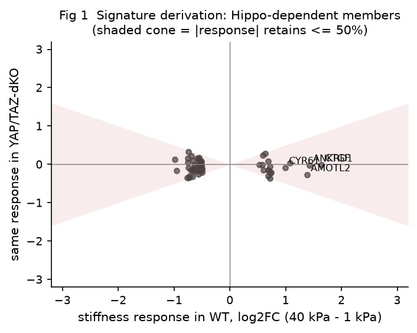
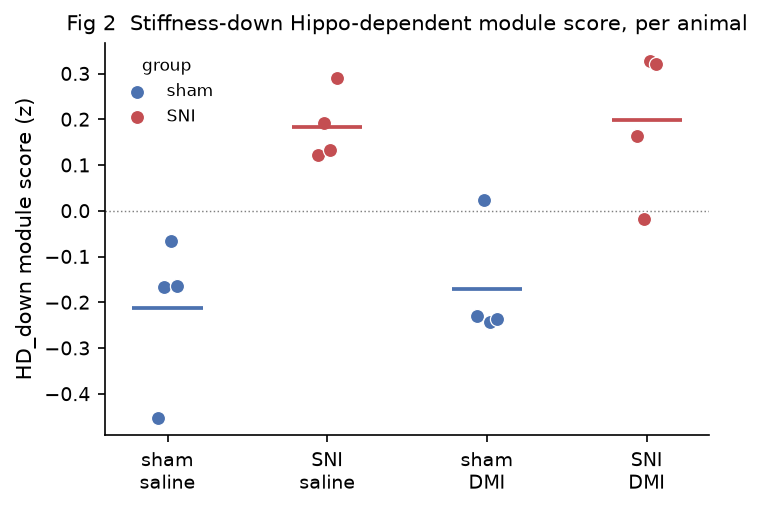
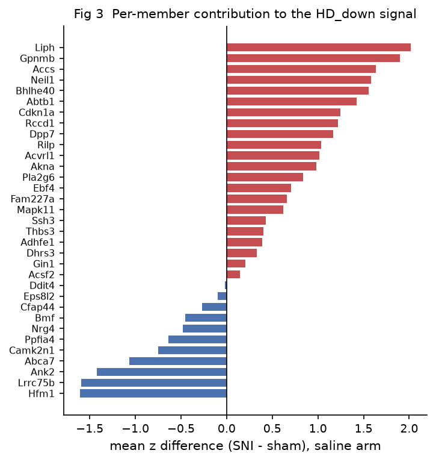
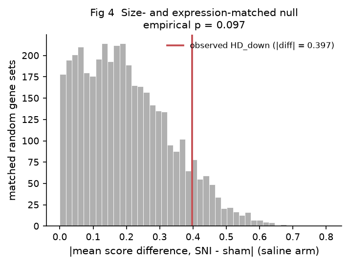
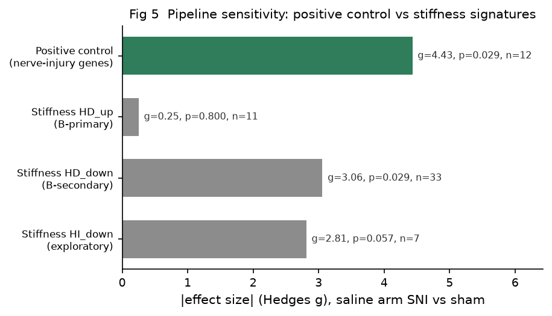
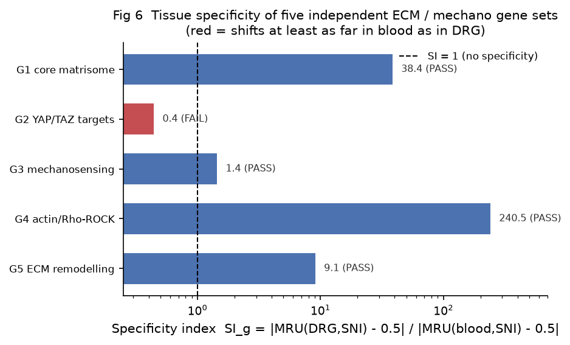
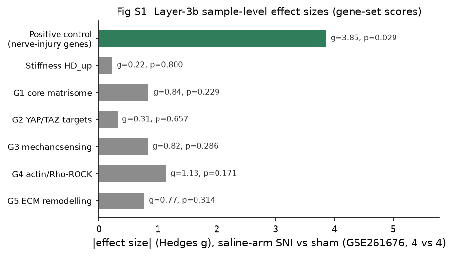

# A controlled stiffness signature does not transfer to neuropathic-pain transcriptomes, while established ECM/mechanotransduction gene sets show tissue-specific shifts

**Yongxin Yang** (ORCID 0009-0004-9698-6552)
The Second Affiliated Hospital of Fujian University of Traditional Chinese Medicine, Fuzhou, Fujian 350003, China

---

## Abstract

Chronic-pain transcriptomes show enrichment of broad extracellular-matrix (ECM) gene sets, yet no one has tested with a controlled mechanical driver whether a stiffness-driven program reaches pain-relevant tissue. We ran a prospectively specified two-stage reanalysis. A YAP/TAZ–TEAD-dependent stiffness signature (HD_up 18; HD_down 41) from GSE98547 (HEK293A, 1 vs 40 kPa, four genotypes) was projected onto GSE111216 (four tissues × two pain models) and GSE261676 (mouse dorsal root ganglion [DRG], spared-nerve-injury [SNI] model); we froze endpoints before seeing the pain data. The signature was biologically anchored (CTGF Δ = +1.64, P = 9.5 × 10⁻⁶), and a sample-level positive control confirmed sensitivity (12-gene nerve-injury set: +1.285, P = 0.0286, g = 3.85). In Stage A DRG×SNI HD_up gave median-rank utility (MRU) = 0.717, P = 0.102, BH q = 0.409; blood (BLD) was equally non-significant (q = 0.409); the §5.3 rule (equally significant control required) did not apply, so Stage A is a plain double-null. In Stage B HD_up produced a bounded null (+0.146, P = 0.80, g = 0.219). The failure is signature-specific: only 1/5 ECM sets lacked specificity (SI_g 0.44–240.5); G1 and G5 reached BH significance (q = 0.0010, 0.0016) but share 10 members, whereas G4's ratio is a denominator artefact. With a sample-level, sensitivity-validated pipeline we find no detectable transfer of the HEK293A-derived stiffness program to pain tissue at the 4-vs-4 resolution. This is a sensitivity-validated null, not a methodological one. The failure is specific to this signature and cell type, not to projection generally. Once baseline-expression confounding is controlled, established ECM/mechanotransduction sets show a DRG-over-blood shift for matrisome/fibrosis (G1, G5) and mechanosensory (G3) modules. Our result does not disprove the literature's "ECM enrichment in pain" claim; it limits that claim to the projected signature's source cell type.

## Background

Neuropathic-pain transcriptomes consistently show upregulation of extracellular-matrix (ECM) and mechanotransduction-related terms [2,5,7]. The usual reading is that mechanical-signalling programs are engaged in injured sensory pathways. Two gaps undercut that reading. First, "ECM organization" is a broad Gene Ontology term covering hundreds of housekeeping collagens and glycoproteins; its enrichment does not isolate a mechanistically defined program. Second, the direction of causality is unclear: ECM changes may be downstream sequelae rather than drivers of the pain state.

A cleaner test requires a signature whose mechanical driver is *experimentally manipulated*, not inferred. GSE98547 [1] varied substrate stiffness (1 kPa vs 40 kPa) across four Hippo-pathway genotypes, allowing the stiffness response to be decomposed into Hippo-dependent (HD) and Hippo-independent components. Projecting such a controlled signature onto pain transcriptomes asks a falsifiable question: does the *same* mechanically defined program re-appear in injured DRG/SC?

We pre-registered this question as a reanalysis with frozen endpoints, dual negative controls, and a positive-control sensitivity test, to avoid the HARKing and selection biases that undermine post-hoc enrichment claims.

A prospective, sensitivity-validated design lets us separate a *true* bounded null (a genuine absence that survives a sensitivity check) from a *methodological* null (one that would also erase real signal). Drawing that distinction is the point of this reanalysis. It tells us, once calibrated, where a controlled stiffness program does and does not engage pain transcriptomes.

## Methods

### Data sources
Three public datasets were used (all re-use of de-identified public data; no new subjects). GSE98547 [1] (human HEK293A, 4 genotypes × 2 stiffness × 3 replicates = 24 samples) trained the signature. GSE111216 [2] (mouse; DRG, spinal cord SC, brain BRN, blood BLD × SNI and CFA models, n = 3 per contrast, per-contrast summary statistics) provided the first projection. GSE261676 [3] (mouse DRG; SNI vs sham × saline/DMI, 4 vs 4 sample-level counts) provided sample-level validation.

### Signature derivation (Layer 0)
Per gene, the stiffness response was computed as log₂(FPKM + 1) contrast (40 kPa − 1 kPa) within each genotype. HD genes were those responding in WT but whose response was abolished in YAP/TAZ-dKO, operationally |Δ_YTKO| ≤ 0.5|Δ_WT| after Welch testing; assignment uses the YAP/TAZ-dKO contrast only. We use "Hippo-pathway-dependent" to mean YAP/TAZ–TEAD-dependent; per Dupont 2011 [4] the mechanical YAP/TAZ response is independent of the upstream Hippo/LATS cascade, so HD is operationally defined by YAP/TAZ-dKO abolition, not LATS dependence. LATS1/2-dKO was profiled in GSE98547 and used only for the directional confirmation metric below, never for HD assignment. This yields HD_up (n = 18) and HD_down (n = 41). LATS-confirmation was computed as the fraction of HD (vs HI) genes whose YAP/TAZ-dependence was *directionally* confirmed: the sign of the WT stiffness response agreed between the WT estimate and the YAP/TAZ-dKO (or LATS-dKO) estimate (both positive or both negative), so the response was blunted, not reversed, upon YAP/TAZ loss.

### Projection and endpoints (Stage A, Layer 1)
The pre-specified primary endpoint was rank-based concordance of HD_up in DRG×SNI, using the median-rank utility (MRU = median(member rank)/(n_expressed − 1), 1-based; 0.5 = no shift) against a size- and baseline-expression-decile-matched null (without replacement, 10 000 iterations). Negative controls were BLD and BRN. The pre-specified governance rule (§5.3; deposited frozen protocol, PROTOCOL_基质刚度与神经病理性痛.md, tag v1.0.0) states that if a negative control is *equally* significant to the primary, tissue-specific attribution cannot be made.

### Sample-level module scores (Stage B, Layer 2)
On GSE261676, each gene was converted to CPM → log₂(CPM + 1) → per-gene cross-sample z-score; set scores were member-z means. The B-primary was the saline-arm SNI-vs-sham HD_up score difference, tested by exhaustive exact permutation over all C(8,4) = 70 possible 4-vs-4 splits (two-sided), cross-checked with Welch t and Mann–Whitney U. Hedges g provided the effect size.

### Positive control and bias controls
A 12-gene nerve-injury marker set (ATF3, SPRR1A, GAL, NPY, SOX11, GAP43, NGFR, VGF, STMN4, BASP1, MMP9, TIMP1) was run through the *identical* Stage B pipeline. Because this set shares zero members with the stiffness signature and was selected from literature only, its detection validates pipeline sensitivity; its failure would void all null conclusions.

### Generality benchmark (Layer 3)
Five literature-sourced ECM/mechanotransduction gene sets were projected with the same MRU statistic onto GSE111216: G1 core matrisome [5], G2 YAP/TAZ canonical targets [4,9,10], G3 mechanosensitive channels and focal-adhesion module [6,11,12], G4 actin/Rho/ROCK cytoskeleton [13,14], G5 ECM remodelling/fibrosis [7,8]. The specificity index SI_g = |MRU(DRG,SNI) − 0.5| / |MRU(BLD,SNI) − 0.5|; SI_g < 1 denotes failure of tissue specificity. The pre-specified primary rule: if ≥ 4/5 sets fail specificity, the lack of specificity is a *general* property of projection, not of one signature.

### Sample-level divergence (Layer 3b) and positive characterisation (Layer 4)
Layer 3b re-tested the five sets plus HD_up and the positive control on GSE261676 sample-level data (exact permutation, Hedges g). Layer 4 characterized genes *actually* upregulated in injured DRG (per-gene Welch t over 15 345 detection-passed genes, BH correction), reporting how many fell in G1/G4/G5 and comparing to HD_up members via Fisher exact test.

## Results

### Layer 0: a biologically anchored stiffness signature
The HD_up set (n = 18) is anchored by established YAP/TAZ targets: CTGF (Δ = +1.64, P = 9.5 × 10⁻⁶), CYR61 (+0.99), ANKRD1 (+1.43), and AMOTL2 (+1.38). Three of the eighteen members are canonical YAP/TAZ–TEAD effector targets (CTGF, CYR61, ANKRD1); a fourth, AMOTL2, is a YAP/TAZ-binding regulator rather than a transcriptional effector. The remaining fourteen are heterogeneous (adhesion, cytoskeletal, and regulatory genes) that meet the Hippo-dependence criterion (Figure 1). LATS confirmation was 79.7% for HD versus 28.6% for HI genes, confirming that the HD classification captures genuine Hippo-pathway dependence (Figure 1, shaded cone). The signature is therefore biologically meaningful *as a controlled in vitro program*, while its "core" is mechanistic rather than a uniform set of canonical targets.

### Stage A: both target and blood controls are null (no tissue-specific engagement)
Under the pre-specified expression-matched calibration, DRG×SNI HD_up gave MRU = 0.717, exact/permutation P = 0.102, BH q = 0.409 (not significant). The blood negative control was *statistically indistinguishable*: MRU = 0.696, P = 0.100, q = 0.409 (Table 2). The pre-specified governance rule (§5.3) is triggered only when a negative control is *equally significant* to the target; here both DRG and blood are non-significant, so the rule does not apply and Stage A is a plain double-null: no tissue-specific engagement of the HEK293A program can be claimed, but the result is also not informative about mechanism. Three P values apply to this contrast. The full-background unstratified calibration gives DRG P = 0.597 and BLD P = 0.0009; the diagnostic unstratified test in the matched null space gives DRG P = 0.055 and BLD P = 0.085; and the expression-matched primary endpoint gives DRG P = 0.102 and BLD P = 0.100. Only the last is pre-specified and governs the verdict. A separate, non-pre-specified unstratified calibration (full background including 40–58% zero-expression loci; baseline-zero fractions DRG 42.8%, BLD 58.5%, SC 41.0%, BRN 40.5%; Kolmogorov–Smirnov D ≈ 0.49 throughout) gave DRG P = 0.597 and BLD P = 0.0009, a pattern driven by the zero-expression confound and explicitly *not* the primary endpoint.

### Stage B: bounded null for HD_up; pipeline sensitivity proven
In the sample-level 4-vs-4 test, HD_up showed a bounded null (difference = +0.146, exact P = 0.80, Hedges g = 0.219; coverage 0.611, 11/18 members expressed in mouse DRG); the bounded null and the positive-control detection are shown together in Figure 5. The positive control, run through identical scoring/permutation code, was detected at the 4-vs-4 lower bound (difference = +1.285, exact P = 0.0286, Hedges g = 3.85; Mann–Whitney P = 0.0286) (Figure 5). The 17.6-fold Hedges-g gap between positive control and HD_up, on identical code, shows the sample-level pipeline genuinely detects a real DRG signal and is not blind to the signature; the HD_up null is therefore *sensitivity-validated* rather than a method failure. The exact-permutation lower bound (P ≈ 0.029) means only large effects are detectable at this 4-vs-4 design, so the null is bounded at this design rather than tightly bounded in absolute magnitude. HD_down reached a nominally significant but BH-non-significant (q = 0.086) reverse elevation (difference = +0.397, P = 0.0286, g = 2.658) and is reported **as hypothesis-generating only** (Figures 2, 3, and 4); Figure 4 places its observed value in the upper tail of a size- and expression-matched random-gene-set null, consistent with the leave-one-animal-out and Q4-expression-matched checks that the elevation is not a single-animal artifact.

### Layer 3: specificity retained by established sets; the projection failure is signature-specific
Against the matched null, the five sets behaved heterogeneously (Figure 6, Table 3): G1 (SI = 38.4), G3 (SI = 1.44), G4 (SI = 240.5), and G5 (SI = 9.06) all showed *stronger* DRG-than-blood shift, whereas G2 (YAP/TAZ canonical targets, SI = 0.44) failed. Only 1/5 sets lacked specificity, so the pre-specified primary rule (≥ 4/5 failing) was **not** met, and we could *not* show that specificity failure is universal. Of 40 tests (5 sets × 4 tissues × 2 models), 8 survived BH correction (q < 0.05), all in DRG/SC/BRN with none in blood. The "retained specificity" reading needs tempering. G1 and G5 share 10 members (43% of G5's 23), so the apparent 4/5 success partly reflects one overlapping matrisome/fibrosis module counted twice, and G4's large SI is a denominator artefact (blood MRU ≈ 0.5, |Δ| ≈ 0.0009; see Table 3 footnote); the 40 tests are not independent (G1 and G5 share 10 members), so the BH q-values remain valid (conservative under positive dependence) and the independent specificity wins are G1, G3, and G5, with G1 and G5 correlated. The stable, BH-significant signal is the DRG-over-blood shift of G1 and G5 (both q = 0.0010 and 0.0016 in DRG×SNI); G3 retains specificity by SI (1.44) but does not reach BH significance and was not upregulated at the sample level (Layer 3b).

### Layer 3b and Layer 4: sample-level confirmation and descriptive characterisation
Layer 3b did not support a divergence pattern: 0/5 ECM sets were significantly upregulated in the saline-arm SNI-vs-sham test (Hedges g 0.31–1.13; positive control g = 3.85, P = 0.0286; HD_up g = 0.219, P = 0.80); its primary endpoint FAILED (S1 Fig). The positive-control BH q = 0.200 in Table 4 is the 7-set family adjustment at the sample level and does not contradict the Stage B sensitivity pass; only the 4-vs-4 exact P governs that endpoint. Layer 4 characterized injured DRG directly: of 15 345 tested genes, 8 were significantly upregulated (q < 0.05) and 3 down; the ECM-union (G1/G4/G5) contributed 0 significant-up genes (Fisher OR = 0, P = 1.0), and HD_up members contributed 0. Layer 4's primary endpoint FAILED, confirming the descriptive landscape is not dominated by ECM-structure upregulation.

## Discussion

### What the data show
The results establish a working pipeline and localise the failure precisely. The signature was biologically anchored (CTGF Δ = +1.64, P = 9.5 × 10⁻⁶), and the *sample-level* positive-control test passed with full separation (nerve-injury set difference = +1.285, P = 0.0286, Hedges g = 3.85), confirming the sample-level arm can detect a true DRG signal. Against that baseline, four pre-specified primary endpoints were tested. Stage A, Layer 3b, and Layer 4 did not confirm the hypothesised tissue-specific engagement, and the Layer-3 *universal-failure* primary was also not met. The Stage A and Layer-3/3b/4 nulls are interpreted differently: Stage A is a plain double-null (both DRG and blood non-significant, so the §5.3 rule for an *informative* negative control is not triggered and no tissue-specific attribution can be made); Stage B's HD_up null is *sensitivity-validated at the sample level* (the 17.6-fold Hedges-g gap to the positive control shows the sample-level arm is not blind, though the exact-permutation lower bound of P ≈ 0.029 means the null is bounded at this design, not tightly bounded in absolute magnitude). The Layer-3 benchmark's positive reading needs qualifying. The apparent "4/5 sets retain specificity" is inflated because G1 and G5 share 10 members (one overlapping matrisome/fibrosis module counted twice) and G4's large SI is a denominator artefact (blood MRU ≈ 0.5); the stable, BH-significant signal is the DRG-over-blood shift of G1 and G5 (q = 0.0010 and 0.0016 in DRG×SNI), and a mechanosensory signal in G3 (SI = 1.44) that retains specificity but does not reach BH significance. The spurious "blood shifts more than DRG" pattern seen in the unstratified Stage A calibration is explained by baseline zero-expression confounding (40–58% of loci), which the matched null corrects.

Two distinct claims must not be conflated. Layer 3 establishes *rank-projection direction-of-shift specificity*: whether each set's membership shifts more in DRG than in blood. There, G1, G3, and G5 are affirmed, but the apparent count is inflated because G1 and G5 overlap by 10 genes and G4's ratio is unstable (see Table 3 footnote); the genuine, independent wins are G1, G3, and G5, of which G1 and G5 reach BH significance. Layer 3b and Layer 4 instead ask whether these sets are *upregulated in injured DRG at the sample level*; there the design is simply underpowered and inconclusive. Specificity retained in the rank projection does not entail sample-level upregulation, nor does the latter's absence negate the former.

A mechanosensory reading of G3. G3 (SI = 1.44, retains specificity) is not a pure adhesome but a mix of eight mechanosensitive ion channels (PIEZO1/2, TRPV4, TRPA1, TRPC1/6, KCNK2/4) and focal-adhesion proteins. Piezo and TRP channels are the canonical *in-vivo* mechanical-pain transducers, so their emergence here as a DRG-over-blood module fits a possible mechanosensory engagement of injured sensory neurons. We flag this only as a hypothesis: it rests on rank-projection specificity (SI = 1.44) and was not upregulated at the sample level (Layer 3b, G3 diff = −0.277, P = 0.286). G3's ion-channel signal is the mechanistically interesting Layer-3 result, and it reframes the pain-relevant question. The issue is not "does any ECM program transfer?" but "which kind of mechanotransduction engages pain tissue?"

So we adjust the interpretation against the pre-registered hypotheses. The cross-cell-type projection of a *HEK293A-derived* stiffness program does not transfer to mouse pain DRG/SC, and the simplest explanation is a **cell-type- and mechanical-input-specific** limit of this particular HEK293A-derived, substrate-fibronectin-stiffness program (HEK293A epithelium ≠ sensory neuron/glia), not evidence that pain-ECM findings are artifacts. Our null therefore limits the literature's "ECM enrichment in pain" claim to the source cell type of the projected signature, without disproving it.

### Core conclusions
1. A stiffness-controlled experiment can yield a biologically anchored mechanosignature (CTGF Δ = +1.64, P = 9.5 × 10⁻⁶); the signature itself is sound.
2. Projecting that signature onto pain transcriptomes yields no tissue-specific evidence of engagement (Stage A a double-null with §5.3 not triggered; Stage B a bounded null), but this is a *sample-level sensitivity-validated* null, not a method artifact.
3. The failure is signature- and cell-type-specific: expression-stratified projection recovers a DRG-over-blood shift for established ECM/mechanotransduction modules (G1, G5, and the mechanosensory G3), so literature "ECM enrichment in pain" findings are not invalidated by our result.

### Limitations
This study re-uses public data with inherent constraints: GSE111216 deposits only per-contrast summary statistics (n = 3), preventing sample-level and behavioural-covariate analysis and meaning the Layer-3 benchmark rests on small per-contrast samples; GSE261676 is a 4-vs-4 design whose exact-permutation lower bound is P ≈ 0.029. HEK293A is non-neuronal, so the signature captures a mechanistically defined (YAP/TAZ–TEAD-dependent) but not neuron-specific program; cross-species symbol mapping is required and HD_up coverage in mouse DRG was 0.611. The mechanical input also differs between the two settings: culture-substrate fibronectin stiffness versus nerve compression or perineural fibrosis in vivo. Cell-type and mechanical-input mismatches are therefore confounded and cannot be separated here. The post-hoc observation that YAP/TAZ-class targets (G2) lose their DRG-over-blood shift while the matrisome/fibrosis modules (G1, G5) and the mechanosensory module (G3) retain a DRG-over-blood shift is a hypothesis, not a finding; G4's apparent shift is a denominator artefact (blood MRU ≈ 0.5) and is not counted as evidence. Because the Layer-3 benchmark rests on n = 3 per-contrast summary statistics and the G1/G5 modules overlap by 10 genes, its positive reading is hypothesis-generating rather than confirmatory. We are not aware of direct DRG literature that separates these programs in neuropathic pain, and independent validation is required. HD_down is likewise hypothesis-generating only. The Layer-3 primary endpoint (universal specificity failure) was not met; generality of the *signature-specific* null is therefore asserted only for the HD_up program and its source cell type.

## Declarations
**Ethics.** This study was a secondary analysis of public, de-identified transcriptomic datasets (GSE98547, GSE111216, GSE261676) deposited in the Gene Expression Omnibus; no new human or animal subjects were enrolled or surveyed, and no identifiable private information was accessed. Because it uses only pre-existing, de-identified public data, the work does not require institutional review board (IRB) approval or individual consent; the original GEO deposits carried their own ethical approvals and consent procedures at source.
**Data availability.** Source datasets: GSE98547, GSE111216, GSE261676 (Gene Expression Omnibus). Analysis code, configuration, and all result artifacts are deposited at https://github.com/yyx-4113/matrix-stiffness-neuropathic-pain (tag v1.0.0) with a MANIFEST of checksums; every numeric claim in this manuscript is traceable to a file under `analysis/results/`. The CTGF Δ and P reported as the Layer-0 biological anchor are recomputed from the regenerated wild-type stiffness contrast; the per-replicate FPKM source for GSE98547 is deposited so the anchor is fully reproducible.
**Competing interests.** The author has declared that no competing interests exist.
**Funding.** The author received no specific funding for this work.
**Authors' contributions.** YY conceived, performed, and wrote the analysis and manuscript.
**Acknowledgements.** None.

---

## Tables

**Table 1. Dataset characteristics.**

| Dataset | Species / cell | Design | Role | Key limitation |
|---|---|---|---|---|
| GSE98547 | *H. sapiens* / HEK293A | 4 genotypes × 2 stiffness (1, 40 kPa) × 3 reps = 24 | Layer 0 signature training | Non-neuronal; cross-species mapping required |
| GSE111216 | *M. musculus* | 4 tissues (DRG, SC, BRN, BLD) × 2 models (SNI, CFA), n = 3 per contrast, summary stats | Layer 1 projection | Per-contrast summary only; n = 3; 40–58% zero-expression baseline |
| GSE261676 | *M. musculus* / DRG | SNI vs sham × saline/DMI, 4 vs 4 sample-level counts | Layers 2–4 sample-level | Small n (4v4); drug-arm confound |

**Table 2. Endpoint results summary.**

| Layer / endpoint | Statistic | Result | Pre-specified verdict |
|---|---|---|---|
| Stage A primary (HD_up × DRG × SNI, matched) | MRU = 0.717, P = 0.102, q = 0.409 | not sig; blood control equally non-significant (MRU = 0.696, P = 0.100, q = 0.409) | §5.3 not triggered (double null) |
| Stage B primary (HD_up, saline SNI vs sham, 4v4) | diff = +0.146, P = 0.80, g = 0.219 | bounded null | not sig |
| Stage B positive control (injury markers) | diff = +1.285, P = 0.0286, g = 3.85 | detected | PASS (sensitivity) |
| Stage B HD_down (secondary) | diff = +0.397, P = 0.0286, q = 0.086, g = 2.658 | nominally sig, BH-ns, reverse dir | hypothesis-generating |
| Layer 3 primary (≥ 4/5 sets fail specificity) | 1/5 failed (G2 SI = 0.44) | rule not met | primary FAIL |
| Layer 3 secondary | 8/40 BH-significant (all DRG/SC/BRN; blood 0) | n/a | n/a |
| Layer 3b primary (divergence) | 0/5 ECM sig up; pos control P = 0.0286 | no divergence | primary FAIL |
| Layer 4 primary (positive characterisation) | 8/15 345 genes sig up; ECM-union sig up = 0 | ECM not dominant | primary FAIL |

**Table 3. Layer-3 generality benchmark (specificity index, SI_g).**

| Gene set | Source | MRU target (DRG, SNI) | MRU blood (BLD, SNI) | \|ΔDRG−0.5\| | \|ΔBLD−0.5\| | SI_g | Specificity failed? |
|---|---|---|---|---|---|---|---|
| G1 core matrisome | Naba 2016 [5] | 0.9056 | 0.5106 | 0.4056 | 0.0106 | 38.4 | No |
| G2 YAP/TAZ canonical targets | Dupont 2011 [4] / Cordenonsi 2011 [10] / Zhao 2008 [9] | 0.6180 | 0.7681 | 0.1180 | 0.2681 | 0.44 | Yes |
| G3 mechanosensitive channels + focal-adhesion | Coste 2010 [6] / Ranade 2014 [11] / Zaidel-Bar 2007 [12] | 0.8040 | 0.7114 | 0.3040 | 0.2114 | 1.44 | No |
| G4 actin/Rho/ROCK | Ohashi 2017 [13] / Riento & Ridley 2003 [14] | 0.7224 | 0.4991 | 0.2224 | 0.0009 | 240.5 | No |
| G5 ECM remodelling/fibrosis | Wynn 2008 [7] / Henderson 2020 [8] | 0.8857 | 0.4574 | 0.3857 | 0.0426 | 9.06 | No |

*SI_g = |MRU(DRG,SNI)−0.5| / |MRU(BLD,SNI)−0.5|, computed from full-precision MRU; the \|Δ\| columns are rounded to 4 d.p. and will not exactly reproduce SI by division. G4's denominator is unstable: blood MRU = 0.499075, |ΔBLD−0.5| = 0.000925, so SI_g (≈240) is undefined to within an order of magnitude and the absolute shifts must be read directly. G1 and G5 overlap by 10 members (43% of G5's 23), so their two specificity "wins" are not independent; the BH q-values remain valid (conservative under positive dependence), but the "4/5 pass" tally double-counts one overlapping matrisome/fibrosis module. Four of five sets show |ΔDRG−0.5| > |ΔBLD−0.5| (all except G2), i.e., retain DRG-over-blood specificity. G1's own denominator (|ΔBLD−0.5| = 0.0106) is also small, so its SI ≈ 38 is a rough index rather than a precise ratio; the robust fact is G1's large, BH-significant DRG MRU (0.906).*

**Table 4. Layer-3b sample-level results (saline arm, 4 SNI vs 4 sham, exact permutation).**

| Gene set | n present | diff (SNI−sham) | P_exact | Hedges g | BH q |
|---|---|---|---|---|---|
| G1 core matrisome | 62 | +0.513 | 0.229 | 0.839 | 0.440 |
| G2 YAP/TAZ canonical targets | 12 | +0.174 | 0.657 | 0.310 | 0.767 |
| G3 mechanosensitive channels + focal-adhesion | 22 | −0.277 | 0.286 | −0.823 | 0.440 |
| G4 actin/Rho/ROCK | 20 | +0.393 | 0.171 | 1.131 | 0.440 |
| G5 ECM remodelling/fibrosis | 21 | +0.371 | 0.314 | 0.766 | 0.440 |
| HD_up | 11 | +0.146 | 0.800 | 0.219 | 0.800 |
| Positive control (injury) | 12 | +1.285 | 0.0286 | 3.853 | 0.200 |

*The HD_up and positive-control rows reproduce the Stage B results (identical GSE261676 computation); they are repeated here only to position the ECM sets against the sensitivity-validated anchors and are not independent tests.*

---

## References

1. Meng Z, Qiu Y, Lin KC, et al. RAP2 mediates mechanoresponses of the Hippo pathway. *Nature*. 2018;560(7720):655–660. PMID: 30135582. doi: 10.1038/s41586-018-0444-0.
2. Parisien M, Samoshkin A, Tansley SN, et al. Genetic pathway analysis reveals a major role for extracellular matrix organization in inflammatory and neuropathic pain. *Pain*. 2019;160(4):932–944. PMID: 30763288. doi: 10.1097/j.pain.0000000000001471.
3. Serafini RA, Ramakrishnan A, Shen L, Zachariou V. Desipramine induces anti-inflammatory dorsal root ganglion transcriptional signatures in the murine spared nerve injury model. *Neurobiol Pain*. 2024;15:100153. PMID: 38549875. doi: 10.1016/j.ynpai.2024.100153.
4. Dupont S, Morsut L, Aragona M, et al. Role of YAP/TAZ in mechanotransduction. *Nature*. 2011;474(7350):179–183. PMID: 21654799. doi: 10.1038/nature10137.
5. Naba A, Clauser KR, Ding H, Whittaker CA, Carr SA, Hynes RO. The extracellular matrix: Tools and insights for the "omics" era. *Matrix Biol*. 2016;49:10–24. PMID: 26163349. doi: 10.1016/j.matbio.2015.06.003.
6. Coste B, Mathur J, Schmidt M, et al. Piezo1 and Piezo2 are essential components of distinct mechanically activated cation channels. *Science*. 2010;330(6000):55–60. PMID: 20813920. doi: 10.1126/science.1193270.
7. Wynn TA. Cellular and molecular mechanisms of fibrosis. *J Pathol*. 2008;214(2):199–210. PMID: 18161745. doi: 10.1002/path.2277.
8. Henderson NC, Rieder F, Wynn TA. Fibrosis: from mechanisms to medicines. *Nature*. 2020;587(7835):555–566. PMID: 33239795. doi: 10.1038/s41586-020-2938-9.
9. Zhao B, Ye X, Yu J, et al. TEAD mediates YAP-dependent gene induction and growth control. *Genes Dev*. 2008;22(14):1962–1971. PMID: 18579750. doi: 10.1101/gad.1664408.
10. Cordenonsi M, Zanconato F, Azzolin L, et al. The Hippo transducer TAZ confers cancer stem cell-related traits on breast cancer cells. *Cell*. 2011;147(4):759–772. PMID: 22078877. doi: 10.1016/j.cell.2011.09.048.
11. Ranade SS, Woo SH, Dubin AE, et al. Piezo2 is the major transducer of mechanical force for touch sensation in mice. *Nature*. 2014;516(7529):121–125. PMID: 25471886. doi: 10.1038/nature13980.
12. Zaidel-Bar R, Itzkovitz S, Ma'ayan A, Iyengar R, Geiger B. Functional atlas of the integrin adhesome. *Nat Cell Biol*. 2007;9(8):858–867. PMID: 17671451. doi: 10.1038/ncb0807-858.
13. Ohashi K, Fujiwara S, Mizuno K. Roles of the cytoskeleton, cell adhesion and rho signalling in mechanosensing and mechanotransduction. *J Biochem*. 2017;161(3):245–254. PMID: 28082721. doi: 10.1093/jb/mvw082.
14. Riento K, Ridley AJ. Rocks: multifunctional kinases in cell behaviour. *Nat Rev Mol Cell Biol*. 2003;4(6):446–456. PMID: 12778124. doi: 10.1038/nrm1128.

---

## Figure Legends

**Figure 1.** Layer-0 signature derivation. Scatter of the substrate-stiffness response (log₂FC, 40 kPa − 1 kPa) in wild-type HEK293A (x-axis) versus YAP/TAZ-dKO (y-axis) for all Hippo-dependent genes (both HD_up and HD_down). The shaded cone marks the dependence criterion |response in YAP/TAZ-dKO| ≤ 0.5 × |response in WT|; genes inside the cone are classified Hippo-dependent. Four anchors are labelled: CTGF, CYR61, ANKRD1 (canonical YAP/TAZ–TEAD effector targets) and AMOTL2 (a YAP/TAZ-binding regulator, not a transcriptional effector). Source: `analysis/results/layer2/fig/fig1_signature_derivation.png`.

**Figure 2.** Per-animal HD_down module scores (z-scored set score) across the four spared-nerve-injury (SNI) study groups (sham/saline, SNI/saline, sham/DMI, SNI/DMI) on GSE261676. Bars mark group means. This visualises the HD_down reverse-elevation secondary endpoint at the individual-animal level. Source: `analysis/results/layer2/fig/fig2_per_animal_scores.png`.

**Figure 3.** Per-member contribution to the HD_down signal. Horizontal bars show the mean z-score difference (SNI − sham, saline arm) for each HD_down member present in mouse dorsal root ganglion; positive values indicate elevation in injured tissue. Source: `analysis/results/layer2/fig/fig3_member_contributions.png`.

**Figure 4.** Calibration check for the HD_down secondary endpoint: a size- and expression-decile-matched random-gene-set null. The histogram shows the distribution of |mean set-score difference (SNI − sham, saline arm)| over 4000 matched draws; the observed HD_down value lies in the upper tail (empirical P). This is a complementary matched-background calibration for HD_down and is distinct from the exhaustive exact-permutation B-primary (HD_up, C(8,4) = 70 splits). Source: `analysis/results/layer2/fig/fig4_matched_null.png`.

**Figure 5.** Pipeline sensitivity: effect sizes (|Hedges g|, saline-arm SNI vs sham, GSE261676) for the positive control (literature-derived nerve-injury gene set), the stiffness HD_up (B-primary), HD_down (B-secondary), and HI_down (exploratory). The positive control (g = 3.85, P = 0.0286) is detected at the exact-permutation lower bound, separated from HD_up (g = 0.219, P = 0.80); the ~17.6-fold gap shows the sample-level pipeline detects a real DRG signal and that the HD_up null is sensitivity-validated rather than a method failure. Source: `analysis/results/layer2/fig/fig5_positive_control_vs_signatures.png`.

**Figure 6.** Layer-3 generality benchmark. Log-scaled bar chart of the specificity index SI_g = |MRU(DRG,SNI) − 0.5| / |MRU(blood,SNI) − 0.5| for the five independent ECM/mechanotransduction gene sets (G1–G5); SI_g < 1 (red) denotes failure of tissue specificity, SI_g ≥ 1 (blue) denotes retention. G2 (YAP/TAZ canonical targets) fails (SI_g = 0.44); G1, G3, G4, G5 appear to pass. Caveat: G1 and G5 share 10 members (one overlapping module counted twice) and G4's large SI_g is a denominator artefact (blood MRU ≈ 0.5), so the apparent "4/5 pass" is inflated. Source: `analysis/results/layer3/fig/fig6_generality.png`.

**S1 Fig.** Layer-3b sample-level effect sizes (|Hedges g|, saline-arm SNI vs sham, GSE261676, 4 vs 4) for the positive control plus six gene sets (HD_up, G1–G5), seven bars in total. Only the positive control is significant (g = 3.85, P = 0.0286); 0/5 ECM sets showed significant upregulation, so the Layer-3b divergence primary endpoint FAILED. The HD_up and positive-control rows reproduce the Stage B results on identical computation. Source: `analysis/results/layer3/fig/figS1_layer3b_effects.png`.
